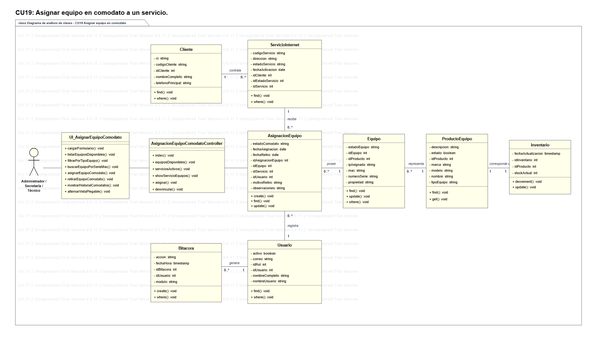

# Diagrama de Análisis de Clases — CU19: Asignar Equipo en Comodato a un Servicio

Diagrama de análisis de clases correspondiente al **CU19: Asignar Equipo en Comodato a un Servicio**, modelado bajo la metodología y estándares de Enterprise Architect (EA) conforme al diagrama de dominio base del sistema **TELCOM**.

---

## 1. Actores Participantes
- **Administrador / Secretaría / Técnico:** Roles con privilegios RBAC (`equipos.view`, `equipos.assign`) para gestionar el inventario, realizar la entrega formal de equipos en comodato a servicios de Internet activos y tramitar retiros/devoluciones.

---

## 2. Clases de Interfaz (Boundary)
- **`UI_AsignarEquipoComodato`**: Interfaz de usuario para la visualización del inventario agrupado por modelos, búsqueda por número de serie / MAC, selección de servicio activo y confirmación de comodato / retiro.
  - `+ cargarFormulario(): void`
  - `+ listarEquiposDisponibles(): void`
  - `+ filtrarPorTipoEquipo(): void`
  - `+ buscarEquipoPorSerieMac(): void`
  - `+ asignarEquipoComodato(): void`
  - `+ retirarEquipoComodato(): void`
  - `+ mostrarHistorialComodatos(): void`
  - `+ alternarVistaPlegable(): void`

---

## 3. Clases de Control (Control)
- **`AsignacionEquipoComodatoController`**: Orquestador de la lógica de negocio y reglas de comodato (precondición de servicio activo, disponibilidad de equipo, actualización atómica de stock en inventario y bitácora).
  - `+ index(): void`
  - `+ equiposDisponibles(): void`
  - `+ serviciosActivos(): void`
  - `+ showServicioEquipos(): void`
  - `+ asignar(): void`
  - `+ desvincular(): void`

---

## 4. Clases de Entidad (Entity)
1. **`AsignacionEquipo` (Entidad Principal)**: Registra el contrato de comodato vinculando el servicio con la unidad física asignada, fecha de entrega y auditoría.
2. **`Equipo`**: Representa la unidad física de telecomunicaciones con número de serie único, dirección MAC e IP.
3. **`ProductoEquipo`**: Catálogo general de modelos de dispositivos (ONUs, Routers, Modems).
4. **`Inventario`**: Control de stock disponible en almacén para cada modelo.
5. **`ServicioInternet`**: Servicio contratado por el cliente que recibe el equipo en comodato.
6. **`Cliente`**: Titular contratante del servicio.
7. **`Usuario`**: Funcionario o técnico que efectúa el registro formal de la asignación.
8. **`Bitacora`**: Registro de auditoría del evento transaccional.

---

## 5. Relaciones y Multiplicidades
- `Cliente` (1) —— **contrata** ——> (0..*) `ServicioInternet`
- `ServicioInternet` (1) —— **recibe** ——> (0..*) `AsignacionEquipo`
- `AsignacionEquipo` (0..*) —— **posee** ——> (1) `Equipo`
- `Equipo` (0..*) —— **representa** ——> (1) `ProductoEquipo`
- `ProductoEquipo` (1) —— **corresponde a** ——> (1) `Inventario`
- `Usuario` (1) —— **registra** ——> (0..*) `AsignacionEquipo`
- `Usuario` (1) —— **genera** ——> (0..*) `Bitacora`

