# Especificación y Modelado UML: CU27 y CU29 (TELCOM)

Documento técnico de análisis y diseño con **Diagramas de Comunicación**, **Análisis de Clases (Boundary-Control-Entity)** y **Diagramas de Secuencia** para los Casos de Uso **CU27** y **CU29**, modelados bajo la metodología y estándares de Enterprise Architect (EA) conforme al esquema de base de datos y código fuente del sistema **TELCOM**.

Archivos generados en `docs/diagramas/`:
- **CU27:**
  - **Imágenes PNG:** [CU27_Diagrama_Comunicacion.png](CU27_Diagrama_Comunicacion.png) | [CU27_Analisis_Clases.png](CU27_Analisis_Clases.png) | [CU27_Diagrama_Secuencia.png](CU27_Diagrama_Secuencia.png)
  - **Vectores / HTML:** [CU27_Diagrama_Comunicacion.html](CU27_Diagrama_Comunicacion.html) | [CU27_Analisis_Clases.html](CU27_Analisis_Clases.html) | [CU27_Diagrama_Secuencia.html](CU27_Diagrama_Secuencia.html)
- **CU29:**
  - **Imágenes PNG:** [CU29_Diagrama_Comunicacion.png](CU29_Diagrama_Comunicacion.png) | [CU29_Analisis_Clases.png](CU29_Analisis_Clases.png) | [CU29_Diagrama_Secuencia.png](CU29_Diagrama_Secuencia.png)
  - **Vectores / HTML:** [CU29_Diagrama_Comunicacion.html](CU29_Diagrama_Comunicacion.html) | [CU29_Analisis_Clases.html](CU29_Analisis_Clases.html) | [CU29_Diagrama_Secuencia.html](CU29_Diagrama_Secuencia.html)

---

# PARTE 1: CU27 &mdash; GENERAR Y EXPORTAR REPORTES TRADICIONALES

## 1.1 Diagrama de Comunicación &mdash; CU27

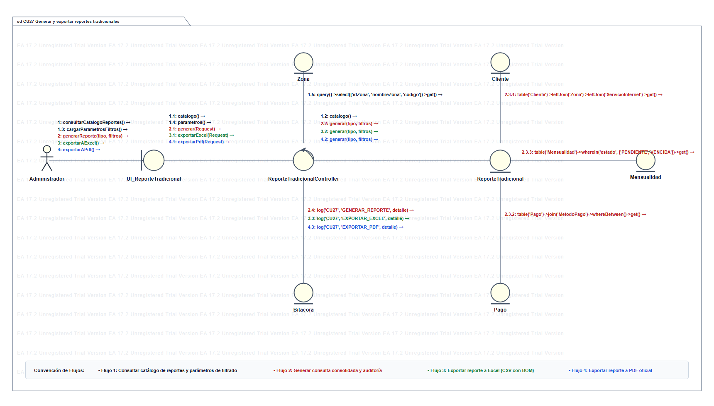

En este diagrama se observan las instancias participantes y la secuencia de mensajes numerados por flujo, reflejando estrictamente los métodos existentes en el código:

### Flujos y Mensajes:
1. **Flujo 1: Consultar catálogo de reportes y parámetros de filtrado**
   - `1: consultarCatalogoReportes() ->` (Administrador &rarr; `UI_ReporteTradicional`)
   - `1.1: catalogo() ->` (`UI_ReporteTradicional` &rarr; `ReporteTradicionalController`)
   - `1.2: catalogo() ->` (`ReporteTradicionalController` &rarr; `ReporteTradicional`)
   - `1.3: cargarParametrosFiltros() ->` (Administrador &rarr; `UI_ReporteTradicional`)
   - `1.4: parametros() ->` (`UI_ReporteTradicional` &rarr; `ReporteTradicionalController`)
   - `1.5: query()->select()->get() ->` (`ReporteTradicionalController` &rarr; `Zona`)
2. **Flujo 2: Generar consulta consolidada y auditoría**
   - `2: generarReporte(tipo, filtros) ->` (Administrador &rarr; `UI_ReporteTradicional`)
   - `2.1: generar(Request) ->` (`UI_ReporteTradicional` &rarr; `ReporteTradicionalController`)
   - `2.2: generar(tipo, filtros) ->` (`ReporteTradicionalController` &rarr; `ReporteTradicional`)
   - `2.3.1: table('Cliente')->leftJoin()->get() ->` (`ReporteTradicional` &rarr; `Cliente`)
   - `2.3.2: table('Pago')->join()->whereBetween()->get() ->` (`ReporteTradicional` &rarr; `Pago`)
   - `2.3.3: table('Mensualidad')->whereIn()->get() ->` (`ReporteTradicional` &rarr; `Mensualidad`)
   - `2.4: log('CU27', 'GENERAR_REPORTE', detalle) ->` (`ReporteTradicionalController` &rarr; `Bitacora`)
3. **Flujo 3: Exportar reporte a Excel (CSV con BOM)**
   - `3: exportarAExcel() ->` (Administrador &rarr; `UI_ReporteTradicional`)
   - `3.1: exportarExcel(Request) ->` (`UI_ReporteTradicional` &rarr; `ReporteTradicionalController`)
   - `3.2: generar(tipo, filtros) ->` (`ReporteTradicionalController` &rarr; `ReporteTradicional`)
   - `3.3: log('CU27', 'EXPORTAR_EXCEL', detalle) ->` (`ReporteTradicionalController` &rarr; `Bitacora`)
4. **Flujo 4: Exportar reporte a PDF oficial**
   - `4: exportarAPdf() ->` (Administrador &rarr; `UI_ReporteTradicional`)
   - `4.1: exportarPdf(Request) ->` (`UI_ReporteTradicional` &rarr; `ReporteTradicionalController`)
   - `4.2: generar(tipo, filtros) ->` (`ReporteTradicionalController` &rarr; `ReporteTradicional`)
   - `4.3: log('CU27', 'EXPORTAR_PDF', detalle) ->` (`ReporteTradicionalController` &rarr; `Bitacora`)

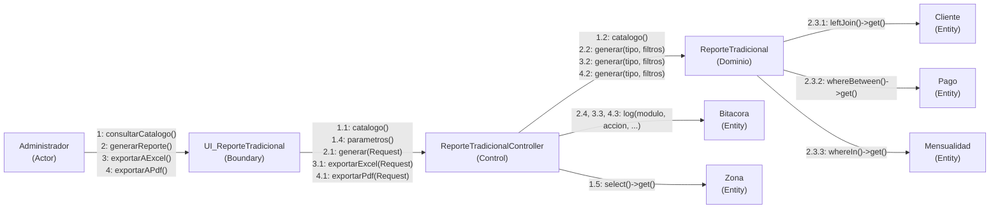

---

## 1.2 Diagrama de Análisis de Clases &mdash; CU27

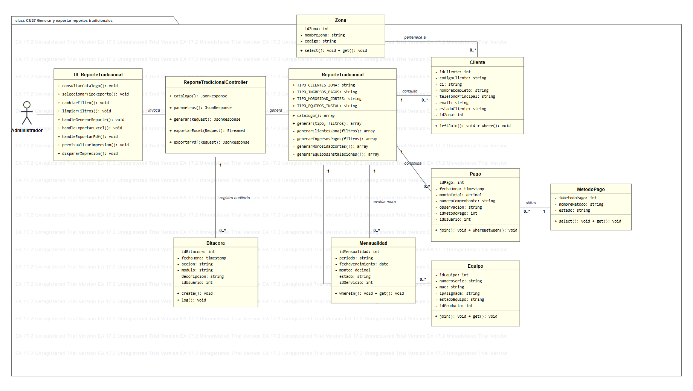

Estructura de clases con estereotipos BCE (Boundary, Control, Entity), tipos de datos según el modelo de datos de TELCOM y métodos extraídos del código:

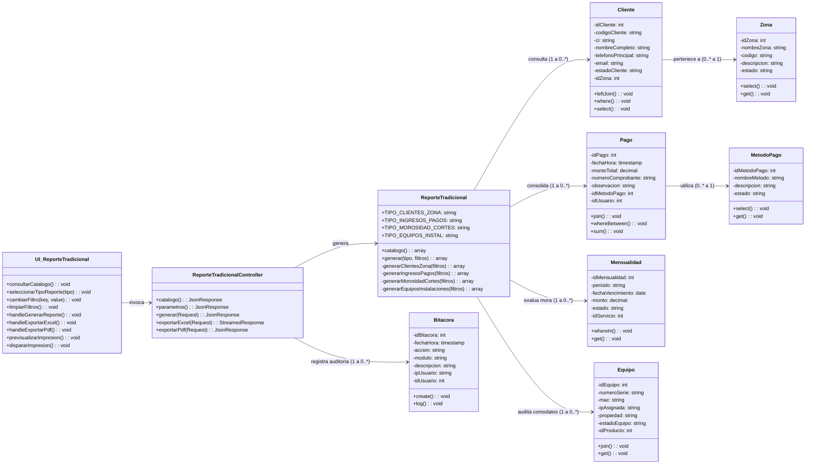

---

## 1.3 Diagrama Secuencial &mdash; CU27

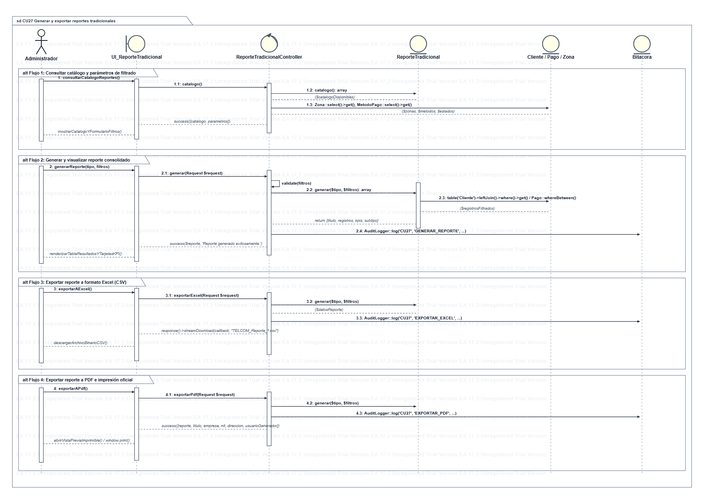

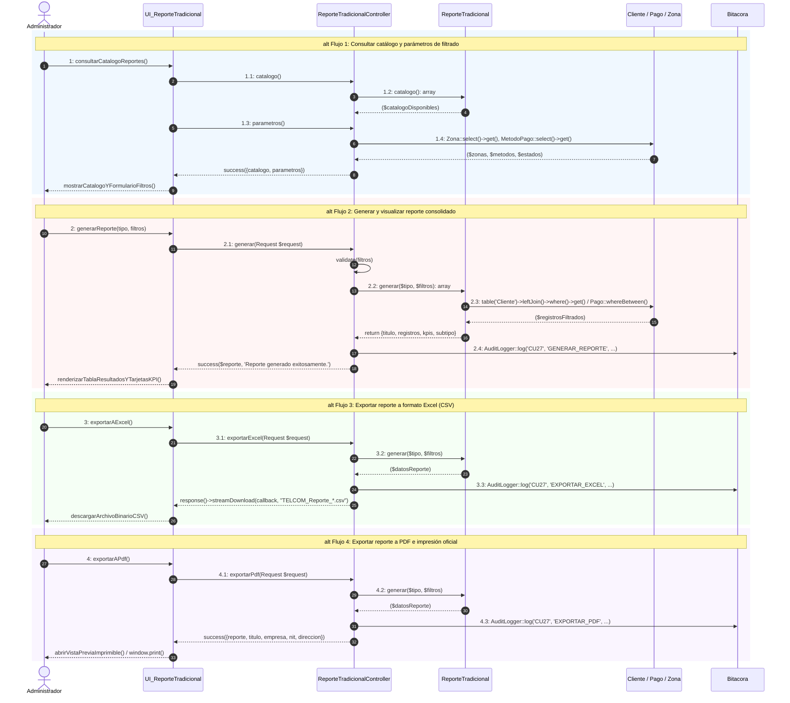

---

# PARTE 2: CU29 &mdash; CAPTURAR Y TRANSCRIBIR COMANDOS DE VOZ

## 2.1 Diagrama de Comunicación &mdash; CU29

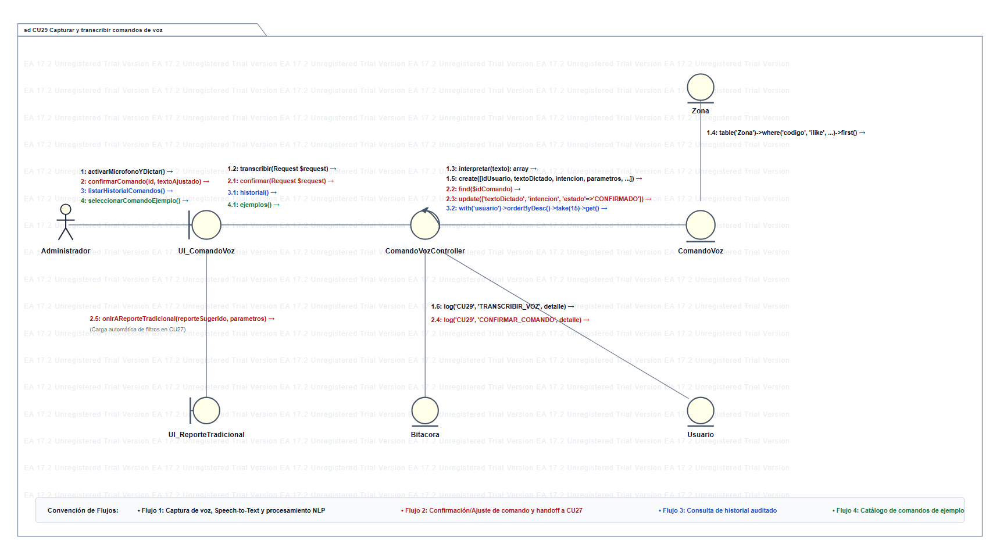

### Flujos y Mensajes:
1. **Flujo 1: Captura de voz, Speech-to-Text y procesamiento NLP**
   - `1: activarMicrofonoYDictar() ->` (Administrador &rarr; `UI_ComandoVoz`)
   - `1.1: WebSpeechRecognition.start() ->` (`UI_ComandoVoz` &rarr; Web Speech API)
   - `1.2: transcribir(Request) ->` (`UI_ComandoVoz` &rarr; `ComandoVozController`)
   - `1.3: interpretar(texto): array ->` (`ComandoVozController` &rarr; `ComandoVoz`)
   - `1.4: table('Zona')->where()->first() ->` (`ComandoVoz` &rarr; `Zona`)
   - `1.5: create([idUsuario, textoDictado, intencion, parametros, ...]) ->` (`ComandoVozController` &rarr; `ComandoVoz`)
   - `1.6: log('CU29', 'TRANSCRIBIR_VOZ', detalle) ->` (`ComandoVozController` &rarr; `Bitacora`)
2. **Flujo 2: Confirmar o ajustar texto transcrito y ejecutar reporte**
   - `2: confirmarComando(id, textoAjustado) ->` (Administrador &rarr; `UI_ComandoVoz`)
   - `2.1: confirmar(Request) ->` (`UI_ComandoVoz` &rarr; `ComandoVozController`)
   - `2.2: find($idComando) ->` (`ComandoVozController` &rarr; `ComandoVoz`)
   - `2.3: update(['estado' => 'CONFIRMADO', 'textoDictado' => ...]) ->` (`ComandoVozController` &rarr; `ComandoVoz`)
   - `2.4: log('CU29', 'CONFIRMAR_COMANDO', detalle) ->` (`ComandoVozController` &rarr; `Bitacora`)
   - `2.5: onIrAReporteTradicional(reporteSugerido, parametros) ->` (`UI_ComandoVoz` &rarr; `UI_ReporteTradicional`)
3. **Flujo 3: Consultar historial de comandos de voz**
   - `3: listarHistorialComandos() ->` (Administrador &rarr; `UI_ComandoVoz`)
   - `3.1: historial() ->` (`UI_ComandoVoz` &rarr; `ComandoVozController`)
   - `3.2: with('usuario')->orderByDesc()->take(15)->get() ->` (`ComandoVozController` &rarr; `ComandoVoz`)
4. **Flujo 4: Consultar catálogo de comandos sugeridos / ejemplos**
   - `4: seleccionarComandoEjemplo() ->` (Administrador &rarr; `UI_ComandoVoz`)
   - `4.1: ejemplos() ->` (`UI_ComandoVoz` &rarr; `ComandoVozController`)

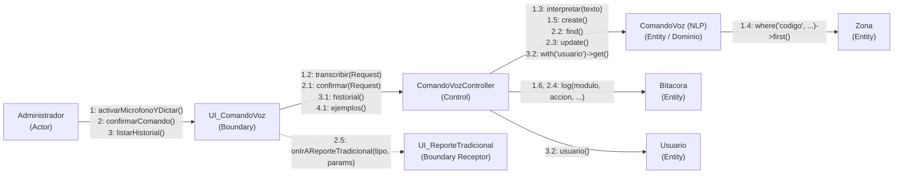

---

## 2.2 Diagrama de Análisis de Clases &mdash; CU29

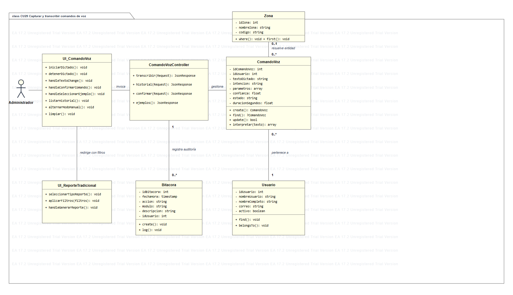

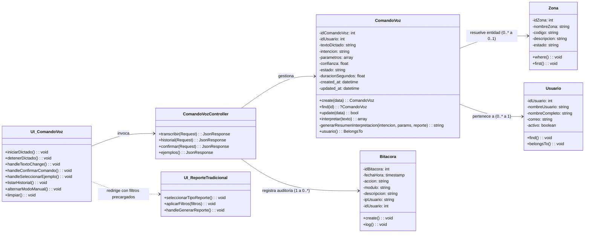

---

## 2.3 Diagrama Secuencial &mdash; CU29

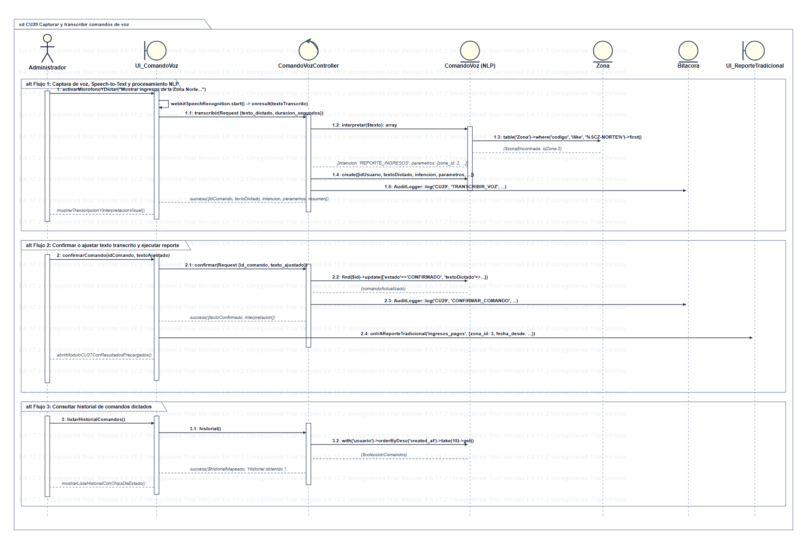

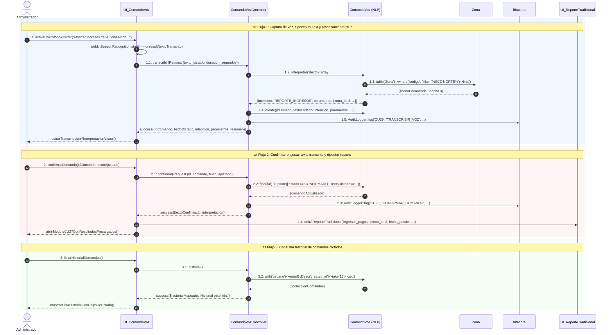

---

## 3. Resumen de Entidades de Base de Datos Utilizadas
1. **`Cliente`**: Identificador, código cliente, CI, nombre completo, teléfono, correo, estado del cliente y zona asignada.
2. **`Zona`**: Identificador, nombre de zona geográfica, código técnico, descripción y estado operativo.
3. **`ServicioInternet`**: Servicios contratados vinculados al cliente y a su zona técnica.
4. **`Pago`** y **`DetallePago`**: Comprobantes de ingresos recaudados en ventanilla, montos totales, fecha/hora y cajero responsable.
5. **`MetodoPago`**: Formas de liquidación (Efectivo, QR, Transferencia Bancaria).
6. **`Mensualidad`**: Cuotas facturadas, períodos fiscales, fechas de corte y estado de mora (Vencida/Pendiente).
7. **`Equipo`** y **`AsignacionEquipo`**: Control de comodatos de ONUs, Routers y módems entregados a servicios.
8. **`ComandoVoz`**: Almacenamiento histórico de dictados por voz, intención semántica calculada, parámetros estructurados y porcentaje de confianza.
9. **`Bitacora`**: Auditoría general del sistema (registro de IP, usuario, módulo, acción transaccional y marca temporal).
